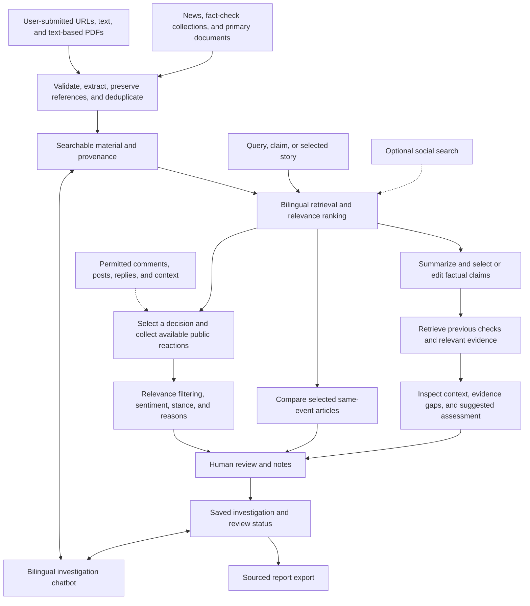

# Bilingual Computational Journalism Platform

**An AI-powered Arabic–English platform for media search, evidence-assisted claim investigation, coverage comparison, and audience-reaction analysis.**

> Helping journalists investigate claims, compare reporting, and understand collected audience reactions through traceable sources.

**Stage:** Scope definition and planning  
**Implementation:** Not started  
**Document status:** Current product scope and proposed functional design  
**Last updated:** 23 November 2026

## 1. Project Overview

The platform helps journalists and fact-checkers search Arabic and English material, identify factual claims, find previous checks, investigate evidence, compare coverage of the same event, and save sourced findings. A bilingual chatbot provides conversational access to investigation material.

Audience-reaction analysis helps users examine how people in a collected sample feel about a specific decision or issue and whether they support or oppose it. This analysis is separate from checking whether a factual claim is supported by evidence.

The core investigation workflow uses news, fact-check collections, primary documents, and user-submitted material. **Social platforms are additional search sources.** The platform must remain usable when social search is disabled, unavailable, or returns no suitable results. Audience-reaction analysis requires suitable reaction data; when that data is unavailable, the platform reports the limitation and the core investigation continues.

The platform is an investigation assistant. Findings must remain traceable to source passages, dates, and context. AI assessments remain provisional, and insufficient evidence must be stated explicitly.

### Scope and Decision Status

- The main capabilities below describe the intended product; they are not implemented functionality or a commitment to deliver every capability in the first MVP.
- The pipelines are a proposed functional design, independent of a particular technology stack.
- Specific publishers, APIs, models, assessment labels, quality targets, and deployment choices remain candidates until selected and validated.
- Automatic search means the platform retrieves material in response to an investigation query. Continuous monitoring and recurring alerts remain optional enhancements.

## 2. Target Audiences

### Primary: Journalists and Fact-Checkers

A detailed investigation experience for:

- Finding, editing, and investigating claims.
- Collecting evidence and checking its context.
- Comparing coverage across sources and languages.
- Examining collected audience reactions to a specified decision.
- Reviewing AI suggestions and recording conclusions.
- Saving investigations and exporting sourced reports.

### Secondary: General Public

A simplified experience for:

- Submitting a claim, article link, text, or PDF.
- Finding relevant previous fact-checks.
- Reading understandable, evidence-backed explanations.
- Inspecting sources, dates, limitations, and review status.

Both audiences use shared underlying capabilities. Public access does not expose private investigations or uploaded documents. Audience-reaction analysis is primarily a journalist workflow; its presentation in the simplified public experience remains to be decided.

## 3. Main Features and Boundaries

| Feature | What it does | Main output |
|---|---|---|
| **Bilingual semantic search** | Search in Arabic or English and retrieve relevant material in either language. Filter by source, date, and language. | Ranked documents and relevant passages with source references. |
| **Content submission** | Accept article URLs, pasted text, and text-based PDFs, including reports, press releases, and research papers. | Extracted, inspectable content with provenance and PDF page references. |
| **Summarization and claim extraction** | Summarize selected material and suggest factual claims. Users can edit claims and choose which to investigate. | A source-grounded summary and editable claims linked to original passages. |
| **Previous fact-check retrieval** | Find existing checks and inspect whether their dates, entities, quantities, and context match the current claim. | Historical checks with their original assessments, publishers, dates, and contextual differences. |
| **Evidence-assisted claim assessment** | Retrieve relevant evidence, inspect support or contradiction, identify gaps, and suggest an explained assessment for human review. | A provisional assessment with cited evidence and unresolved questions. |
| **Same-event coverage comparison** | Compare selected articles' shared facts, differing claims, and emphasis. | A comparison supported by excerpts from the articles. |
| **Audience-reaction analysis** | Analyse sentiment and support/opposition toward an explicitly selected decision using relevant collected reactions. | Sample distributions, recurring reasons, example reactions, links, and collection limits. |
| **Investigation workspace and reporting** | Save claims, sources, evidence, notes, comparisons, and available reaction analysis; record reviewer conclusions and export a report. | A saved investigation and a sourced report with review status. |
| **Bilingual investigation chatbot** | Answer questions about selected documents and investigation material in Arabic or English. | Contextual answers with citations and stated uncertainty. |

### PDF Support

Initial support covers **text-based PDFs**.

- Preserve page references for citations and allow extracted text to be inspected against the original.
- Identify uploads as user-provided material, not automatically trustworthy evidence.
- Keep uploads private by default.
- Report extraction failures, missing text, and unsupported documents clearly.

OCR for scanned or image-only PDFs is an optional enhancement. File-size, page-count, layout, retention, and deletion limits remain open decisions.

### Audience-Reaction Analysis

The user specifies the decision or issue whose reception they want to understand. For example: **"The university's decision to make attendance compulsory."** The source article supplies context; its author's writing tone is not a substitute for people's reactions.

| Analysis | Question | Working labels / output |
|---|---|---|
| **Sentiment** | What emotional tone does the reaction express in context? | Positive, negative, neutral; mixed and ambiguous cases require an explicit handling policy. |
| **Decision-relative stance** | Does the reaction support or oppose the selected decision? | Support, oppose, no clear position. |
| **Reasons summary** | What reasons recur in the collected reactions? | Supporting and opposing arguments, grounded in linked examples. |

These are working annotation definitions to validate before implementation. Stance toward a different target must not be silently substituted. A question about a decision's details may express no clear position. A model's uncertainty is distinct from a confident prediction that no position is expressed.

Example: **"Compulsory attendance will be exhausting, but I support the decision."** This can express negative sentiment while supporting the decision.

Reaction analysis is separate from factual verification. **"Did the university announce compulsory attendance?"** is an evidence question. **"Do the collected comments support compulsory attendance?"** is an audience-reaction question. Neither audience agreement nor emotional tone establishes factual correctness.

Display results as **reactions in the collected sample**, with counts, source coverage, and dates. The sample does not establish what the whole population thinks. Lack of retrieved reactions does not establish lack of public discussion.

### Chatbot Scope

The chatbot is a conversational interface to the platform's investigation capabilities. Initial support focuses on selected documents, collected evidence, and saved analysis. Autonomous open-ended investigation is outside the initial chatbot scope.

Example questions:

- "What are the main factual claims in this PDF?"
- "Has this claim already been checked?"
- "Which passages contradict this statement?"
- "How does the Arabic coverage differ from the English coverage?"
- "What reasons for opposing this decision appear in the collected reactions?"
- "What evidence is missing, and why did you suggest this assessment?"

Answers should cite relevant passages or PDF pages, acknowledge uncertainty, and distinguish what a document says from what evidence establishes. If answering requires additional search, make that clear and use only enabled sources. Do not silently change saved claims, notes, or conclusions.

### Shared Essentials

- Arabic and English interface support, including right-to-left Arabic layout.
- Original-language text, source links, publication/retrieval dates, and evidence provenance.
- Editable claims and reviewable AI analysis.
- Distinct AI suggestions, historical fact-check assessments, and reviewer conclusions.
- Explicit insufficient-evidence and unavailable-data outcomes.

## 4. Sources and Their Roles

Several features reuse the same content. A retrieved article may support search, summarization, claim extraction, coverage comparison, and chatbot answers. A source's relevance does not establish its reliability.

| Source group | Proposed acquisition route / examples | Features it supplies |
|---|---|---|
| **News coverage** | Selected Arabic and English publishers through available feeds, permitted article access, or a news-discovery service. Exact publishers and connectors are undecided. | Search, summaries, claim extraction, candidate evidence, and coverage comparison. |
| **Previous fact-checks** | Candidate collections such as AraFacts, published fact-check articles, and Google Fact Check Tools search. These are candidate integrations, not confirmed live access. | Previous-check retrieval and leads for further evidence investigation. |
| **Primary documents and data** | Original announcements, policy documents, statistical releases, research papers, and other material appropriate to the claim. | Evidence investigation and contextual interpretation. |
| **User-provided material** | Article URLs, pasted text, and text-based PDFs. | Summaries, claim extraction, document search, investigation context, and chat. |
| **Public reactions** | Accessible and permitted news-site comments and optional social-platform posts, replies, or quotes. | Audience sentiment, decision-relative stance, and summaries of recurring reasons. |
| **Social checks and statements** | Fact-checkers' posts, original organizational statements, and candidate community-check collections such as Community Notes. | Additional claim sources, attributed previous assessments, and candidate evidence links. |
| **Saved investigation records** | Selected sources, notes, reviewed claims, analysis, and reviewer decisions. | Workspace, chatbot context, and report export. |

Keep source roles explicit: **claim source**, **reaction**, **candidate evidence**, or **previous check**. An original announcement can establish what an institution announced; assertions inside it may still require independent evidence. Community-check helpfulness is distinct from a verified truth label.

### Additional Social Search

- Automatic social search supplements the main search and investigation pipeline; it is not the project's foundation.
- Disabled connectors, approval delays, quota limits, and failed searches must not block the core workflow.
- Search access and access to a discovered post's full replies/context must be evaluated separately.
- Prioritize free access. A small capped paid pilot may be considered separately; no spending or final provider selection is implied by this plan.
- Bluesky, Threads, and X are researched candidates, subject to access and Arabic-coverage tests. No platform is selected yet.
- User-submitted social posts remain an optional extra, and do not replace automatic discovery.

See the dated [social-media access research note](research/Social_Media_Access_and_Analysis_Research.md) for candidate access routes. That note predates the clarification that audience stance primarily concerns support/opposition toward a decision. This README defines the current product scope and analysis target; platform recommendations in the note remain proposals to recheck before use.

### Content Sources versus Research Resources

Content sources supply the material users investigate. Datasets, benchmarks, and model checkpoints support development and evaluation. A historical dataset is not a live search service, and an embedding model is not an evidence source.

## 5. Optional Extra Features

These enhancements are outside the initial implementation scope unless explicitly promoted.

| Feature | Scope |
|---|---|
| **User-submitted social posts** | Accept post text and an optional URL for the relevant analysis workflow. Identify its submitted origin and report when the original cannot be fetched or authenticated. |
| **Framing and persuasion-technique analysis** | Identify emphasized perspectives and rhetorical techniques with supporting excerpts. Keep this separate from audience reactions and factual correctness. |
| **Event timelines** | Organize related coverage and evidence chronologically. |
| **Topic monitoring and recurring-claim alerts** | Follow topics and notify users about new material or recurring claims. This is additional to investigation-triggered search. |
| **Team collaboration and review assignments** | Share investigations with authorized teammates and record assignments, feedback, and approval status. |
| **Screenshot input and scanned-PDF OCR** | Extract text from images while preserving references and flagging extraction uncertainty. |
| **Browser extension** | Send selected text, claims, or article URLs into the platform. |

## 6. Full Project Pipeline

This is a **proposed functional pipeline**. Users can enter through search, submitted content, or a direct claim. Claim investigation, coverage comparison, and audience analysis are branches; users do not have to complete every branch. The diagram shows how results connect, not a fixed sequence of screens or selected infrastructure.



New material retrieved during an investigation passes through the same intake and provenance process. Only suitable public reactions enter reaction analysis; an article's narrative is not treated as a collection of audience opinions.

### 6.1 Shared Content Intake

**Input:** Permitted retrieved content or a user submission.

1. Identify source type, access conditions, language, and investigation permissions.
2. Validate the URL, text, or file and report inaccessible or unsupported inputs.
3. Extract text while preserving the original material, passage locations, and PDF pages where available.
4. Record source identity, canonical URL, publication date when known, retrieval time, and content origin.
5. Prepare text for search without discarding meaningful negation, entities, numbers, or original-language wording.
6. Identify duplicates and linked copies without counting them as independent evidence or independent reactions.
7. Divide material into retrievable passages and index it using the selected search method. Preserve citation links to the original.

**Output:** Searchable material with provenance and extraction status. Missing metadata remains marked as unknown. Private submissions are available only within the appropriate access scope.

### 6.2 Bilingual Search

**Input:** An Arabic or English query with optional source, date, and language filters.

1. Identify the requested topic and search scope.
2. Prepare query variants where useful while preserving the user's meaning and important entities, dates, and quantities.
3. Retrieve candidates from enabled collections and permitted live sources. Additional social connectors are used only when enabled and relevant.
4. Rank documents or passages for relevance, check contextual differences, and apply the requested filters.
5. Display excerpts, original languages, sources, dates, and access/coverage limits.

**Output:** Ranked results for inspection or use in another branch. An empty result set means no suitable result was retrieved within that scope, not that no evidence exists anywhere. Cross-language relevance must be evaluated rather than assumed from model support.

### 6.3 Summarization, Claim Selection, and Investigation

**Input:** Selected content or a directly entered factual claim.

1. For selected content, generate a source-grounded summary and propose factual claims linked to their original passages.
2. Let the user select or edit the claim. Preserve its relationship to the original text; do not silently change scope or meaning.
3. Search previous checks and rank candidates by both meaning and material context, including time, entities, quantities, and negation.
4. Display original historical assessments and contextual differences. Do not automatically apply a related check to the current claim.
5. Identify investigation questions and retrieve candidate evidence from the selected sources. Additional investigation remains possible even if no prior check is found.
6. Inspect evidence relevance, support or contradiction, source provenance, dates, conflicting accounts, and duplicated reporting. A source agreeing with the claim is not automatically independent verification.
7. Suggest an explanation with citations and explicit evidence gaps. The assessment-label protocol remains to be finalized.
8. Let a reviewer inspect the material, add notes, and record a conclusion or an unresolved outcome.

**Output:** An investigation record containing the claim, previous checks, evidence passages, suggested assessment, limitations, and reviewer conclusion when provided. No retrieved match or insufficient evidence must not automatically become a false verdict.

### 6.4 Same-Event Coverage Comparison

**Input:** Two or more selected articles and the event being compared.

1. Check that the articles concern the same event and relevant time period.
2. Extract comparable facts, claims, entities, dates, and emphasized details.
3. Align corresponding details across Arabic and English material while preserving original excerpts.
4. Identify shared facts, differing claims, and differences in emphasis or included detail.
5. Generate a comparison whose observations link to supporting passages for user review.

**Output:** A cited comparison. Flag different events or inadequate source material rather than forcing a comparison. Differences in emphasis alone do not establish bias or factual error.

### 6.5 Audience-Reaction Analysis

**Input:** A story with an explicitly selected decision/issue, a collection window, and enabled sources of public reactions.

1. Confirm the target: for example, support/opposition toward compulsory attendance, rather than whether the announcement is genuine.
2. Generate relevant Arabic and English search queries and collect accessible comments, posts, replies, or quotes with their available parent context.
3. Filter for reactions to the selected decision. Exclude unrelated material, separate quoted content from the author's position, and account for repeated copies.
4. Analyse sentiment and stance separately. Retain model/version information and flag ambiguous or low-confidence cases for review.
5. Group recurring reasons for support and opposition, keeping each summary grounded in example reactions.
6. Calculate distributions over the stated analysed sample. Show sample counts, collection dates, source coverage, exclusions, and unavailable context.
7. Let the user inspect original reactions and review the analysis before saving or reporting it.

**Output:** Sentiment and stance distributions plus a sourced reasons summary for the collected sample. If suitable data is unavailable or insufficient under the eventual acceptance criteria, show that limitation. The evidence-investigation branch continues independently.

An initially small label set does not imply that sarcasm, mixed feelings, code-switching, or conditional support are solved. Annotation rules and validation must address these cases. Do not use reaction counts to determine a claim's truth or infer an individual's long-term beliefs.

### 6.6 Workspace, Review, and Report Export

**Input:** Selected sources, claims, analysis results, user notes, and reviewer decisions.

1. Save items with their investigation links, source references, dates, and analysis/review state.
2. Keep user edits, AI suggestions, historical verdicts, and reviewer conclusions identifiable.
3. Revisit evidence and record changes when material or conclusions are updated, subject to source retention and refresh rules.
4. Select report sections and assemble findings with citations, limitations, sample descriptions where applicable, and review status.
5. Preview and export the report in a format to be decided. Report unavailable source material explicitly and respect source-specific export restrictions.

**Output:** A saved investigation and a sourced report. Export is distinct from public publication; public publishing controls and permissions remain open decisions.

### 6.7 Bilingual Investigation Chatbot

**Input:** A question, conversation context, selected documents, and the user's accessible investigation material.

1. Identify the question's target and which documents or investigation records are in scope.
2. Retrieve relevant passages and saved analysis, preserving source distinctions.
3. If additional search is needed, state that need and use the enabled search capabilities rather than inventing missing context.
4. Generate an Arabic or English answer with citations and check that cited material supports the answer.
5. Report uncertainty, unanswered questions, or unavailable material. Leave changes to saved claims, notes, and conclusions under user control.

**Output:** A grounded conversational answer. The chatbot uses the same sources and analysis boundaries as the rest of the platform.

## 7. User Workflows

### Journalist / Fact-Checker

1. Search for a story or submit content.
2. Select the appropriate task: investigate a claim, compare selected coverage, or examine reactions to a decision.
3. Review retrieved material and the analysis appropriate to that task.
4. Inspect citations, context, gaps, and source-access limits.
5. Add notes, review AI suggestions, and record findings.
6. Save the investigation or export a sourced report.

The chatbot supports follow-up questions throughout. These tasks can be used independently or combined in one investigation; audience analysis is not a required step in claim verification.

### General Public

1. Enter a claim, paste an article URL/text, or upload a supported PDF.
2. Select a claim if the material contains several.
3. Read relevant previous checks or an evidence-backed explanation.
4. Inspect sources, dates, limitations, and review status, with chatbot explanations where useful.

### Illustrative Combined Investigation

For a story about compulsory university attendance, verify what the university actually announced using relevant evidence, compare selected articles' descriptions, and, if accessible reactions exist, examine support/opposition toward the decision. Save these as distinct findings. A popular opinion cannot resolve whether the reported announcement is accurate.

## 8. Research Foundations

Research supplies candidate datasets, pretrained models, methods, and evaluation practices. These are foundations to assess, not a requirement to reproduce every paper or adopt every model.

| Capability | Candidate research foundations | Potential use |
|---|---|---|
| Previous fact-check retrieval | AraFacts; SemEval-2025 Task 7 | Initial claim collections, matching-task design, and retrieval evaluation. |
| Bilingual semantic search | BGE-M3; Multilingual E5; MIRACL | Search-model candidates, baselines, and relevance evaluation. |
| Claim–article relationships | AraStance | Arabic stance definitions/data for evidence interpretation; distinct from audience support/opposition toward decisions. |
| Evidence-based investigation | AVeriTeC; FEVER | Investigation questions, sourced explanations, and evidence-aware evaluation. |
| Same-event coverage comparison | SemEval-2022 Task 8 | Story-similarity guidelines and evaluation examples. |
| Audience sentiment | Cardiff multilingual sentiment checkpoint; CAMeLBERT Arabic sentiment checkpoint | Candidate sentiment baselines to test on collected Arabic/English reactions. |
| Audience stance toward decisions | MAWQIF; StanceEval 2026 / Mawqif-XT | Target-relative stance guidelines and transfer evaluation; suitability and release access require inspection. |
| Optional media analysis | ArAIEval; SemEval-2023 Task 3 | Persuasion data and genre/framing guidelines. |
| Evidence sufficiency | NoMIRACL | Tests for recognizing when retrieved material lacks an answer. |
| Supporting language understanding | AraBERT; GigaBERT | Foundations for task-specific extraction and classification. |
| Supplementary Arabic inference training | ARAFA | Candidate claim–evidence examples, subject to quality and split checks. |

Supporting references: [paper-by-paper review](research/Paper_by_Paper_Analysis.md), [MAWQIF paper](https://aclanthology.org/2022.wanlp-1.16/), [StanceEval 2026 overview](https://aclanthology.org/2026.arabicnlp-sharedtasks.65/), [Cardiff sentiment model](https://huggingface.co/cardiffnlp/twitter-xlm-roberta-base-sentiment), and [CAMeLBERT sentiment model](https://huggingface.co/CAMeL-Lab/bert-base-arabic-camelbert-da-sentiment).

### Reuse Rules

- Verify licenses, access conditions, processing permissions, attribution, and redistribution requirements separately.
- Inspect dataset quality, overlap, version differences, and train/test separation.
- Preserve task distinctions: relevance, factual support, sentiment, decision-relative stance, persuasion, and factual correctness are not interchangeable.
- Do not assume same-language benchmark results establish Arabic–English performance or that topic-stance results transfer to arbitrary decisions.
- Compare methods on the same project-specific cases and keep final tests separate from development.
- Record dataset versions, model revisions, prompts/configuration, and processing costs. Model scores are not probabilities that a claim is true.

## 9. Proposed Research Improvements

The following are candidates, not finalized commitments or established novelty claims.

### A. Context-Aware Claim Matching

Check dates, quantities, entities, and negation before treating a historical fact-check as applicable.

**Evaluation question:** Does this reduce incorrect matches between similar but materially different claims?

### B. Question-Based Bilingual Evidence Retrieval

Break claims into specific investigation questions, search Arabic and English evidence, and rank passages by usefulness in answering those questions.

**Evaluation question:** Does this retrieve more useful evidence than direct-claim or same-language search alone?

### C. Evidence-Sufficiency Assessment

Identify unanswered questions, conflicts, outdated material, and duplicated reporting before suggesting an assessment.

**Evaluation question:** Does this reduce unsupported conclusions without excessive abstention?

### Candidate Research Focus

> Context-aware Arabic–English evidence retrieval and sufficiency assessment for journalist-assisted claim verification.

A final focus requires reviewing the closest existing work and choosing a feasible contribution. Audience analysis is a product capability; adding it does not automatically establish a separate research contribution. The proposed improvements strengthen existing features rather than expand the feature list.

## 10. Trust and Privacy Principles

- **Evidence first:** Assessments and comparisons link to identifiable passages.
- **Context matters:** Preserve dates, quantities, people, places, negation, quotations, and relevant reply context.
- **Similarity is not verification:** A related article or historical check may concern a different claim.
- **Agreement is not truth:** A supporting source can be incorrect, and repeated reporting is not independent confirmation.
- **Missing evidence is not falsity:** Insufficient retrieved evidence does not automatically mean a claim is false.
- **Separate analysis tasks:** Sentiment, audience stance, framing, and persuasion do not establish factual accuracy.
- **Samples have limits:** Describe collected reactions with counts and coverage limits; do not generalize them to the whole public.
- **Human oversight:** AI findings remain provisional until reviewed. Human review does not guarantee correctness.
- **Transparent provenance:** Distinguish submissions, retrieved material, community checks, historical verdicts, and reviewer conclusions.
- **Private uploads:** Keep uploaded material private by default. Retention, deletion, and external processing policies remain to be decided.
- **Source access:** Respect relevant storage, refresh, deletion, and export conditions. Public visibility alone does not determine permitted reuse.
- **No misleading certainty:** Avoid unsupported truth percentages and blanket "fake news" labels. Report unavailable data and uncertainty explicitly.

## 11. Evaluation Plan

Evaluate individual components and complete workflows. Numerical acceptance targets remain to be agreed; the measurements below are not achieved results.

| Area | Proposed measurements |
|---|---|
| Semantic search | Ranking quality, evidence recall, latency, and results by language direction. |
| Previous fact-check retrieval | Correct-match ranking, false-match rate, and claims with no existing match. |
| Summarization | Faithfulness, coverage of important points, and citation support. |
| Claim extraction | Factuality, clarity, completeness, and faithfulness to the source. |
| Evidence interpretation and assessment | Per-class precision/recall, macro-F1, evidence adequacy, and error analysis. |
| Evidence sufficiency | Unsupported assessments and unnecessary abstentions. |
| Coverage comparison | Correct same-event selection and faithfulness to cited excerpts. |
| Reaction retrieval | Relevance to the specified decision, duplicate handling, context availability, and source/language coverage. |
| Audience sentiment | Per-class results and macro-F1 against annotated reactions, with dialect/mixed/sarcastic-case analysis. |
| Decision-relative stance | Per-class results including no clear position, target consistency, conditional support, uncertainty, and unseen-target performance. |
| Reaction summaries | Faithfulness of reasons to examples, coverage of differing views, and correct sample denominators. |
| PDF processing | Extraction quality and citation-page accuracy. |
| Investigation chatbot | Citation support, faithfulness, follow-up context, and appropriate insufficient-evidence responses. |
| Workspace and reports | Preservation of source references, user edits, conclusions, and review status. |
| End-to-end usefulness | Task completion, investigation time, source clarity, and understanding of uncertainty for the intended audience. |

### Evaluation Safeguards

- Group repeated claims, translations, threads, and closely related events when splitting data.
- Include hard near-matches with changed dates, numbers, entities, or negation.
- Test Arabic → Arabic, English → English, Arabic → English, and English → Arabic retrieval separately.
- Evaluate reaction models on the actual source types, dialects, and unfamiliar targets we intend to support.
- Use documented human annotation/review criteria and record disagreements; model predictions are not gold labels.
- Compare against fixed baselines and report latency/resource costs alongside quality.
- Test missing-source, unavailable-reaction, and disabled-social-search cases. The core investigation must remain usable.

## 12. Roadmap and Progress

The product direction is defined; the first runnable MVP, architecture, research focus, and numerical acceptance criteria still need confirmation. Build the core search and investigation foundation first. Additional social-source feasibility work does not replace the main development milestones.

The [project build blueprint](docs/implementation/README.md) is the master checklist for the full main feature set. Ten linked stage checklists break it into concrete design choices, database/API/screen work, processing features, and tests. Use them to develop the implementation plan and track the actual build; unchecked items are not completed work or finalized technology choices.

### Status Definitions

- **Planned:** Implementation has not started.
- **In progress:** Active work is underway.
- **Implemented:** Functionality exists; validation may remain.
- **Validated:** Tested against documented acceptance criteria.

### Proposed Milestones

| Milestone | Deliverable | Status |
|---|---|---|
| **1. Scope and design** | Confirm MVP, source-access plan, architecture, research focus, annotation rules, and acceptance criteria. | In progress |
| **2. Search foundation** | Shared intake, bilingual search, source references, and previous fact-check retrieval. | Planned |
| **3. Investigation foundation** | Content submission, summaries, editable claims, evidence collection, and saved investigations. | Planned |
| **4. Assessment and reporting** | Evidence-assisted explanations, human review, report export, and chatbot over accessible investigation material. | Planned |
| **5. Coverage comparison** | Compare selected same-event articles with supporting excerpts. | Planned |
| **6. Audience-reaction analysis** | Validate access to suitable reactions, then evaluate sentiment, decision-relative stance, and grounded reasons summaries. Optional social connectors supplement this work. | Planned |
| **7. End-to-end validation** | Validate professional and simplified public workflows, including unavailable-source and unavailable-reaction cases. | Planned |

Bilingual accessibility, privacy, source access, and usability inform development throughout. The milestone order is proposed and does not imply that all main features belong in the first MVP.

### Current Priorities

- Confirm the first runnable core investigation flow and its acceptance criteria.
- Select initial news/fact-check/evidence collections and verify access.
- Choose one primary research improvement and fixed comparison baselines.
- Define assessment labels, reviewer responsibilities, and audience-reaction annotation rules separately.
- Choose a feasible stack, model/compute plan, and deployment approach.
- Evaluate additional reaction sources through a bounded free-first pilot; consider paid access only through a separately authorized cap.

## 13. Open Decisions

| Area | Unresolved decisions |
|---|---|
| First MVP | Included capabilities, first demonstration workflow, and acceptance criteria. |
| Technology | Frontend, backend, storage, search infrastructure, and deployment. |
| AI components | Retrieval, extraction, summarization, evidence interpretation, sentiment, stance, and chatbot models/configuration. |
| Core sources | Initial publishers/collections, live versus indexed retrieval, and permitted access routes. |
| Additional social sources | Platform selection, permissions, Arabic coverage, conversation access, quotas, and any paid cap. |
| Assessment protocol | Labels, evidence-sufficiency rules, and conflicting-evidence handling. |
| Audience analysis | Target definition, mixed/ambiguous reactions, uncertain predictions, sample-size rules, and annotation protocol. |
| Human review | Reviewer eligibility, review records, editing responsibilities, and publication controls. |
| Accounts and access | Authentication, public usage limits, and investigation permissions. |
| Uploads | File/page limits, supported layouts, retention, and deletion. |
| External processing | Which services receive content and under what conditions. |
| Reports | Export formats, required sections, source refresh, and permitted quotations/content. |
| Research contribution | Final improvement, closest baselines, and experimental design. |
| Evaluation | Test collections, quantitative targets, latency/cost targets, and human evaluation. |

## 14. Repository Structure

```text
Grad-Project/
├── README.md                         # Current scope, pipelines, and progress
├── README.pdf                        # Earlier exported snapshot
├── docs/
│   └── implementation/
│       ├── README.md                 # Master project build checklist
│       └── stages/
│           └── 01-*.md … 10-*.md     # Detailed build checklists
├── papers/
│   └── R01.pdf … R15.pdf             # Collected research papers
└── research/
    ├── Bilingual_Computational_Journalism_Literature_Review.pdf
    ├── Paper_by_Paper_Analysis.md
    ├── Paper_by_Paper_Analysis.pdf
    └── Social_Media_Access_and_Analysis_Research.md
```

Research documents are supporting references with their own dates and assumptions. This README records current scope and decisions. PDF copies are snapshots and may lag behind the Markdown; the existing research PDFs have not been revised to incorporate every subsequent scope clarification.

## 15. Setup and Usage

The application has not been implemented yet. Installation, configuration, environment variables, and runnable usage instructions will be added when a working version exists.

## 16. Maintaining This README

Update this document when scope, research, architecture, sources, feature boundaries, pipeline behaviour, acceptance criteria, or milestone status changes. Keep agreed scope, proposed design, researched candidates, and unresolved decisions distinct. Update setup instructions and repository structure as implementation begins, and identify the date of any regenerated PDF snapshot.
